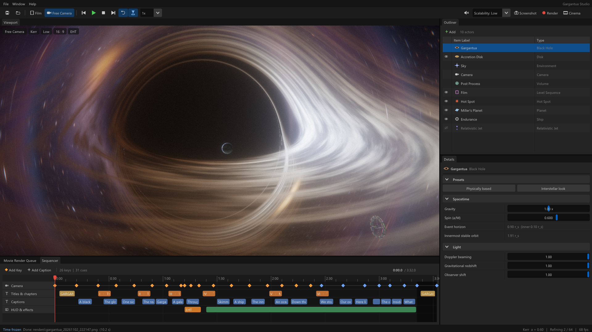
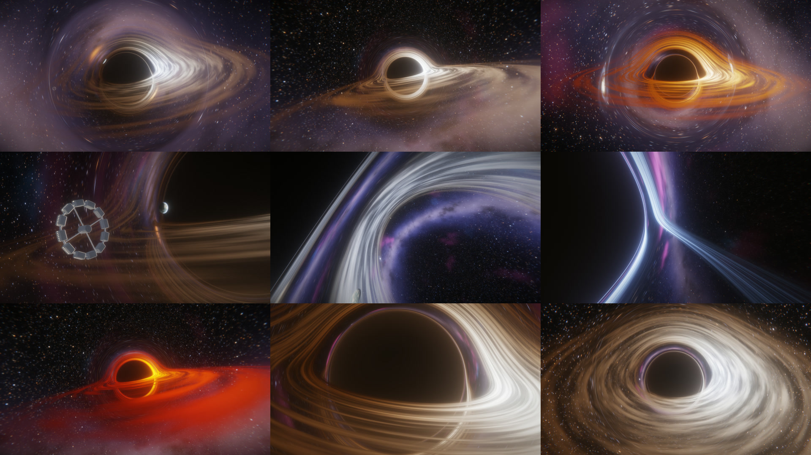
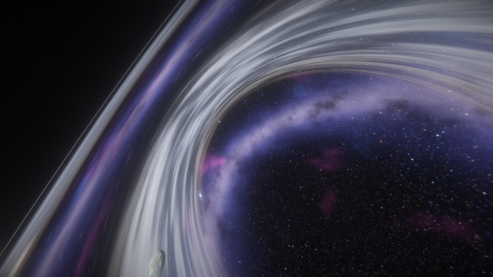
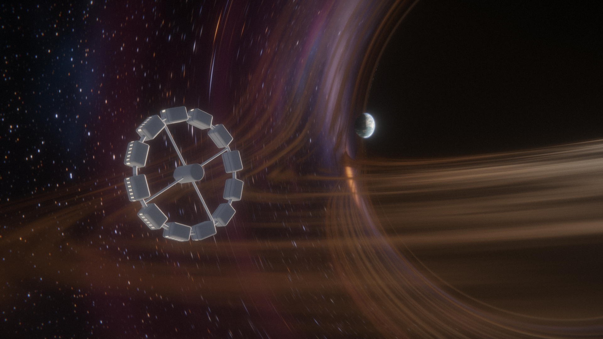
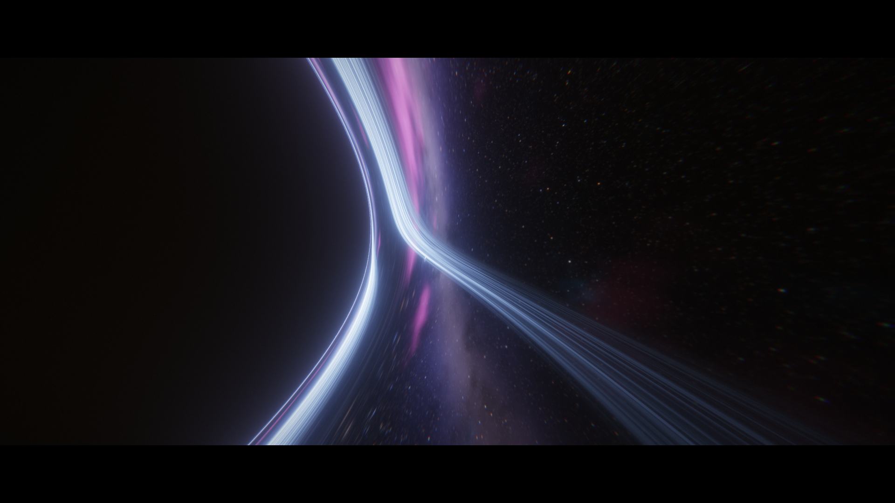
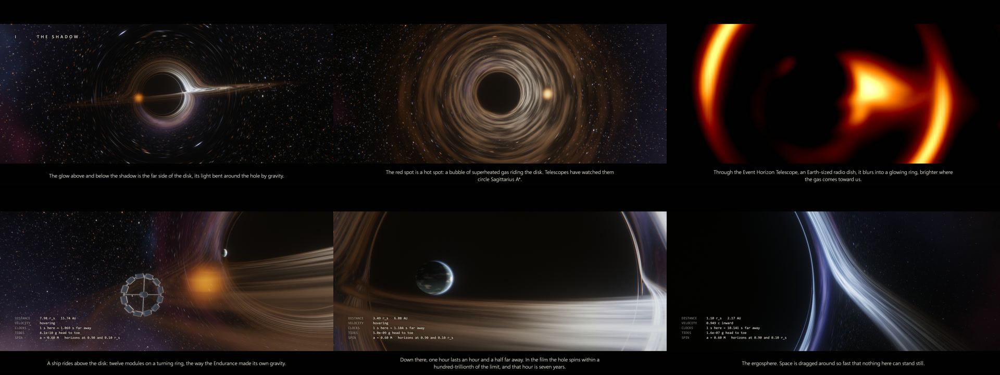
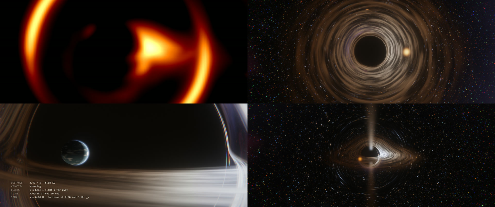
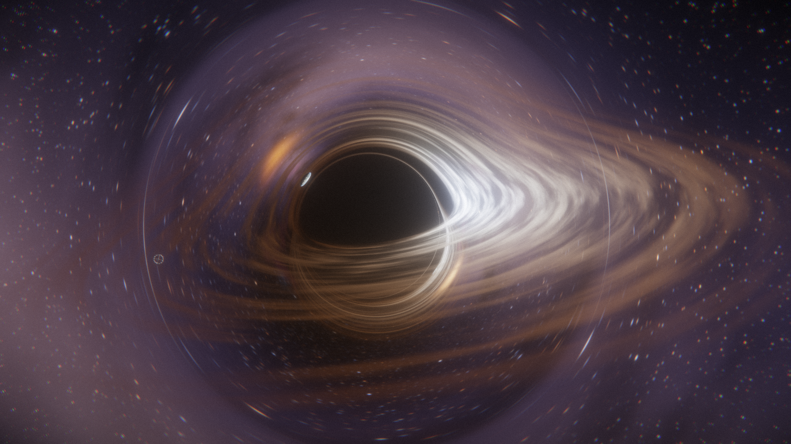

# Gargantua Studio

A real-time black hole ray tracer for Windows, written in C++ with OpenGL and Dear ImGui. Every pixel follows a ray of light through curved spacetime, so the lensing, the lopsided shadow, the Einstein ring and the view from inside the horizon all come out of the maths. There are no textures or fakes. It comes with an Unreal-style editor, a camera sequencer, a physics-driven soundtrack, and a short film, **GARGANTUA**, that orbits the black hole, skims its disk, passes Miller's planet and falls in.

**The editor**:

## How this was made

This project is mostly AI-generated. This morning I decided to test what Claude can do and see how good it is with math, and to compare it with how good it was a few years ago. I was blown away by the results, so I decided to publish it. My earlier Claude benchmark projects are in [cpp_projects/claude-test](https://github.com/pilot2254/cpp_projects/blob/main/claude-test/).

Every image here was rendered by the app: most of them by me while playing with the editor, and the film storyboard and the features sheet by Claude.

## Gallery

| | |
| --- | --- |
|  |  |
| The classic edge-on view. The far side of the disk is bent up over the shadow and down under it. | Falling in. The disk wraps around the shadow, and the Milky Way is bent into an arc. |
|  |  |
| The Endurance passing Miller's planet, both traced through the same curved spacetime as the disk. | Near the horizon, blueshifted by the fall. |

**The film, GARGANTUA**, from the opening shot to inside the horizon:

**The physics features**: the Event Horizon Telescope view, a hot spot riding the disk, Miller's planet with its real time dilation in the HUD, and a relativistic jet beamed toward us:

**2 Min Render:**

## How it works

### 1. One ray of light per pixel, traced backwards

A normal 3D renderer draws triangles. This one doesn't have any. For every pixel on screen, the GPU sends a ray of light out of the camera and follows it into the scene: the reverse of the light that would land on that pixel. Whatever the ray runs into decides the pixel's colour.

In empty space a ray is a straight line. Near a black hole it isn't.

### 2. Gravity bends the light

General relativity says mass curves spacetime, and light follows the straightest possible path through the curve (a *geodesic*). For a black hole that doesn't spin, the shape of every light path obeys one equation (the Binet equation, `u'' + u = 3/2 · r_s · u²`, with `u = 1/r`). The shader walks each ray along it in small steps, up to about a thousand per pixel per frame: the steps are smaller near the hole, where the bending is strongest.

Lengths are measured in **Schwarzschild radii** (r_s), the size of the event horizon. For the film's Gargantua, 100 million times the mass of the Sun, 1 r_s is about 2 AU: twice the distance from the Earth to the Sun.

### 3. What each ray can find

- **The horizon.** If the ray falls in, the pixel is black. The black **shadow** is bigger than the horizon itself (a radius of about 2.6 r_s instead of 1), because light that comes too close spirals in.
- **The accretion disk.** If the ray crosses the plane of the disk inside its edges, it picks up the disk's glow. Because rays bend, you see the far side of the disk too: bent up over the shadow and down under it. That's the famous *Interstellar* look.
- **A scene object.** Hot spots, planets, ships and jets are tested against each piece of the bent ray, so they get lensed like everything else. You can even see a hot spot's second image swing around the ring.
- **Nothing.** If the ray escapes, it samples the sky (stars, the Milky Way, nebulae, a spiral galaxy) in the direction it finally points. Rays that pass close to the hole land on the sky somewhere else entirely, which smears the stars into arcs and turns the galaxy behind the hole into a perfect **Einstein ring**.

### 4. Why the disk looks the way it does

The disk is gas orbiting the hole, hotter toward the inside. Its colour comes from **blackbody** radiation: hot gas glows white-blue, cooler gas orange-red.
- **Doppler beaming.** The gas moves at up to about half the speed of light. The side coming toward you is brighter and bluer, the side moving away dimmer and redder.
- **Gravitational redshift.** Light climbing out of the hole's gravity loses energy and reddens.
- **The inner edge.** Gas can't orbit closer than the *innermost stable circular orbit* (ISCO); it spirals in. That's where the disk stops.
- **The photon ring.** A thin line hugging the shadow: light that circled the hole before escaping.

### 5. Spinning black holes

The film's Gargantua spins, at a = 0.6 (the value *Interstellar*'s renders used). A spinning black hole drags space around with it (**frame dragging**), and light then follows a harder set of equations: Hamilton's equations in Kerr–Schild coordinates, integrated with RK4. What you see:
- **A lopsided shadow,** pushed sideways toward the side of the disk that comes toward you, by about half a Schwarzschild radius. A jet, which comes out of the true spin axis, therefore isn't centred on the shadow.
- **The disk reaches closer in:** the ISCO drops from 3 r_s to 1.91 r_s.
- **The ergosphere,** where space is dragged so fast that nothing can stand still.
- **A second, inner horizon** inside the first. Physics as we know it fails there, so the film stops short of it.

At spin 0 the faster non-spinning tracer runs. Both tracers produce the same image at zero spin, which cross-checks two completely different sets of equations.

### 6. Falling in

The camera is a free-falling observer, and the maths stays exact even inside the horizon, where nothing can hover. While you fall:
- **Aberration** squeezes the view ahead and brightens it.
- **Your own Doppler and gravitational shift** turn light ahead blue and light behind red. The camera's auto exposure stops down, like a real lens would.
- **A black cone** opens below you inside the horizon: no light from our universe can come from that direction.
- **The universe** is squeezed into a band of light around you.

The HUD shows the real numbers for 100 million suns: distance, speed, how much slower your clock runs than one far away, and the tides (gentle for a black hole this big).

### 7. From rays to a picture

The traced image is in high dynamic range. It then goes through bloom, ACES tone mapping, vignette, chromatic aberration, film grain, the letterbox, and a text overlay (titles, captions, HUD) drawn with Windows' GDI. The live preview traces at reduced resolution so it runs on any GPU.
- **Progressive refinement:** when nothing moves, the viewport re-traces the view at full resolution with sub-pixel jitter and averages up to 64 samples.
- **Video export:** each frame averages several sub-frames spread over the shutter time, which gives real motion blur and antialiasing. Frames are traced in small tiles (so the GPU driver never times out) and piped into ffmpeg.

### 8. The sound

There's no recorded music. A synthesiser written in C++ reads the camera's state:
- **An organ** (A minor, in a cathedral reverb) swells as you approach the horizon.
- **A clock** ticks once per second of *far-away* time. It speeds up with time dilation, and stops at the horizon, where no outside clock exists any more.
- **The disk** roars when you're close, **a ship's engines** hum, and **a planet's ocean** swells.
- **An orchestra:** a string section plays the chords from the first frame, and each chord swells and eases like a phrase. A slow theme comes in once the hole is near, played like a bowed line, with an octave joining it as you fall. A choir singing "aah" (three vowel formants on saw waves) comes in closer still. All of it gets brighter and louder as the hole gets closer.
- **Brass impacts:** in the last minute before the horizon, long low brass "braams" with a horn section on top land on every chord change, then every half bar. Each one has a deep drum hit and carries a sine sub-bass an octave below (two octaves where that's still audible), and it's loud. The rest of the low end steps back so the impacts own it.
- **The ending:** at the cut to black the effects stop, and the organ resolves and rings out.

The same code plays live and renders into the video.

### 9. What's exact, and what's artistic licence

Exact: the light paths (both tracers), the shadow, the lensing, the ISCO and horizons, the Doppler and gravitational shifts of the disk and the camera, beaming of the hot spot and the jet, and the HUD's clock rates and time dilation.

Artistic licence:
- **The disk's texture** is procedural noise.
- **Objects:** planet and ship sizes are cinematic (a real planet would be a speck next to Gargantua), and orbit speeds are slowed down so you can watch them. Objects are drawn where they are at the frame's time, ignoring how long their light takes to arrive.
- **The photon ring** is drawn as a smooth line instead of the even thinner rings inside it. Those would only sparkle on a pixel grid.
- **The EHT view** is an approximate telescope blur, not a simulation of the telescope array.

## Features

- **Two exact ray tracers:** non-spinning (Binet equation, leapfrog) and spinning (Kerr–Schild Hamiltonian, RK4).
- **A camera that can fall in,** exact inside the horizon, with aberration and its own Doppler and gravitational shift.
- **An accretion disk** with blackbody colours, Doppler beaming, gravitational redshift and an inner edge at the ISCO.
- **A procedural sky** with stars, the Milky Way, nebulae, and a galaxy that becomes an Einstein ring.
- **Scene objects you can add and delete:** hot spots, planets, ships and relativistic jets.
- **Event Horizon Telescope view.**
- **A physics-driven soundtrack.**
- **Progressive refinement** and a **freeze time** button.
- **Film tools:** a sequencer with spline camera keys, titles, captions, a physics HUD, letterbox and fades.
- **Video export** up to 4K with motion blur and antialiasing.

## Getting started

- **Windows** and a GPU with **OpenGL 3.3**.
- **For video export, install ffmpeg** (`winget install ffmpeg`). Without it, the app writes BMP frames instead of an MP4.
- **Build** with `build.bat`, from an "x64 Native Tools Command Prompt for VS" (MSVC) or any shell with MinGW `g++` on PATH. Then run `gargantua_gl.exe`.

The app opens on the film, playing in a loop. Left-drag the viewport to take over the camera, right-drag to look around, wheel to move closer, **P** to freeze time, **Tab** for a full-window picture. Help > Controls lists everything.

## The film: GARGANTUA (3 min 32 s)

Letterboxed to 2.39:1, with titles, chapter cards and captions:
1. **The shadow.** Deep space, where a tiny black hole bends the stars. Then the approach into the classic edge-on view.
2. **The whirlpool.** Rise to a top-down shot of the whole swirling disk, with the red **hot spot** riding it.
3. **The ring.** A galaxy lines up exactly behind the hole, and gravity bends it into a complete **Einstein ring**. Then the view fades into what the **Event Horizon Telescope** would see.
4. **The disk.** Skim just above the disk as the **Endurance** overtakes the camera. An instrument HUD fades in.
5. **Miller's planet.** An ocean world on the closest stable orbit, lit by the disk. At this spin an hour there lasts about an hour and a half far away. *Interstellar*'s seven years needs a black hole spinning within a hundred-trillionth of the limit.
6. **The fall.** Let go: free fall past the photon orbits, through the ergosphere, across the event horizon, toward the inner horizon. Cut to black, and the music rings out over the end credits.

## Scene objects

**+ Add** in the Outliner creates one; right-click an object to rename, duplicate or delete it; the eye icon hides it. Up to 8 visible objects are traced at once. Each has its own settings in Details and an optional film window (it only appears between two times while the film plays). Objects are saved with the sequence.
- **Hot Spot:** a bubble of superheated gas on an orbit, like the flares observed around Sagittarius A*. Doppler boosted by its real orbital speed.
- **Planet:** an ocean world with swells, clouds and an atmosphere. Details shows its real time dilation for the current spin.
- **Ship:** the Endurance, twelve modules on a spinning ring. It orbits the hole, or flies the film camera's path a little ahead of it, overtaking the camera.
- **Relativistic Jet:** plasma along the spin axis; the side coming toward you is beamed brighter. In the scene but switched off, since the film's Gargantua has none.

## The editor

Laid out like Unreal Engine 5:
- **Toolbar:** save/open, Film / Free Camera, transport, **freeze time**, playback speed; then **Scalability**, Screenshot, Render and Cinema on the right.
- **Viewport:** the live image, with quick buttons for the camera, the black hole type, quality, letterbox and the **EHT** view.
- **Outliner and Details:** the scene's actors, and the properties of whatever is selected.
- **Sequencer:** camera keys and caption clips on tracks. Click to edit, drag a key to retime it, K adds a key, Delete removes one.
- **Movie Render Queue:** resolution, frame rate, samples, shutter, soundtrack, and **Render Film**.
- **Status bar:** messages, the tracer, the preview resolution or refinement progress, and the fps.

Drag panel tabs to rearrange them; Window > Reset Layout restores the default. The preview always starts on **Low** quality; renders always use full quality.

## Renders and the command line

Everything the app renders goes into `renders\` next to the exe: videos (with a WAV of the soundtrack), screenshots (F12), stills, and `ffmpeg_log.txt`. File > Open Renders Folder opens it.

**For a final render:** 1080p or 4K, 60 fps, 16 samples, shutter 0.5, Ultra geodesics. Try 720p with 4 samples first to check the timing.

| Option | Does |
| --- | --- |
| `--stills 30,72,163` | save `renders\still_<time>.png` for each film time, then quit |
| `--render` | render the film to video with the current settings, then quit |
| `--soundtrack file.wav` | write the film's soundtrack, then quit |
| `--at 90` | open the editor with the film paused at 90 s |
| `--res 0`–`3`, `--fps 0`–`2`, `--samples 8` | 720p…4K, 24/30/60 fps, samples per frame |
| `--sequence file.txt`, `--spin 0.9`, `--prefix name_` | your own sequence, the spin, still file names |

In batch modes, errors go to `renders\error_log.txt` instead of a dialog.

## Project layout

| Folder | What's in it |
| --- | --- |
| `src/core` | Reusable in any project: vector maths, an OpenGL 3.3 loader with shader/target/uniform helpers, formatting and timing utilities. |
| `src/sim` | The camera, the scene parameters, scene objects, and CPU-side relativity (observer velocities, Kerr–Schild fields, horizons, ISCO, time dilation, auto exposure). |
| `src/render` | The GLSL shaders, the render passes (scene, bloom, composite), progressive refinement, the text overlay, and the video/screenshot exporter. |
| `src/film` | The sequencer engine and `gargantua_film.cpp`, the film itself as data. |
| `src/audio` | The physics-driven synthesiser, live playback and the offline soundtrack. |
| `src/editor` | The editor: theme and widgets, panels, sequencer, and the frame (menu, toolbar, status bar, docking, viewport). |
| `src/app` | Application state shared by the modules. |
| `src/main.cpp` | Window, input and the frame loop. |
