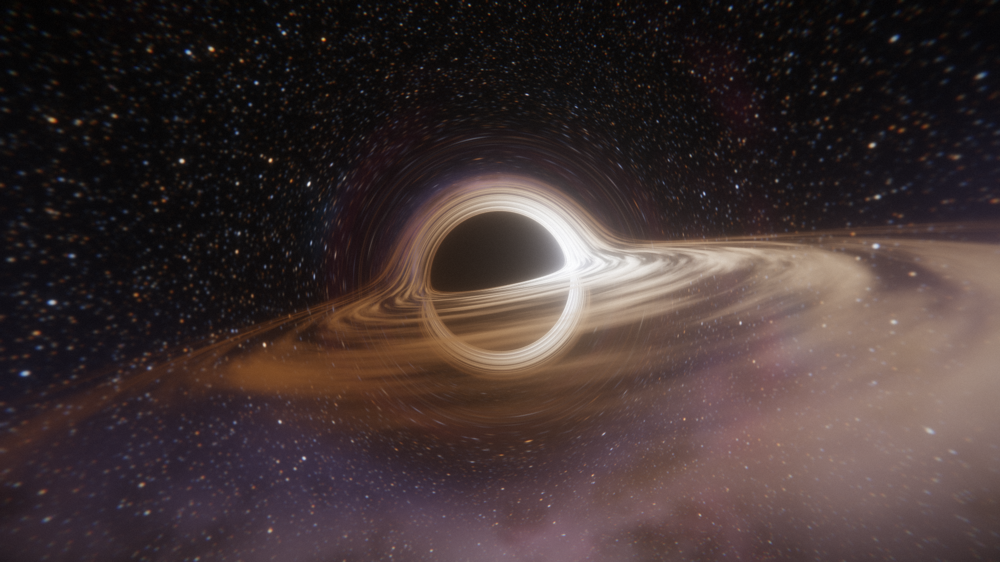
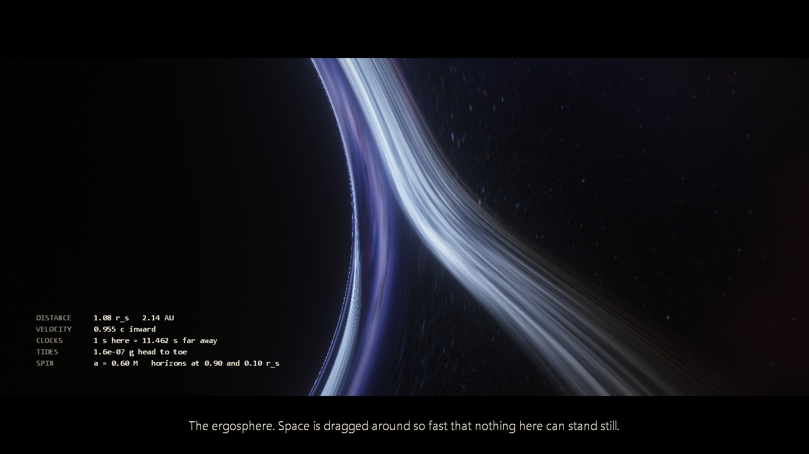
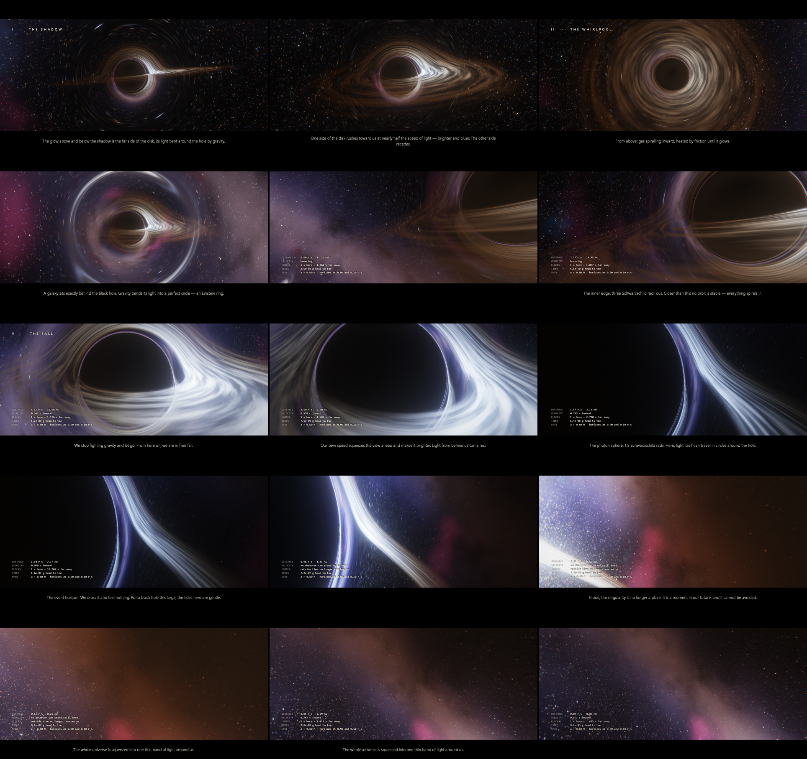
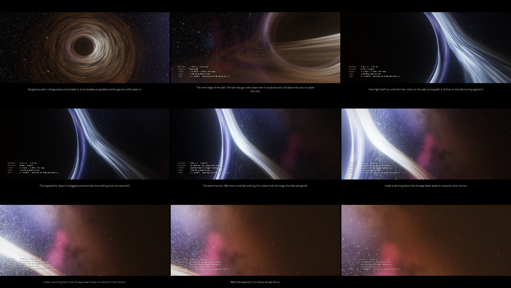

# Gargantua Studio

A real-time black hole ray tracer for Windows, written in C++ with OpenGL and Dear ImGui. Every pixel follows a ray of light through curved spacetime, so the lensing, the lopsided shadow, the Einstein ring and the view from inside the horizon all come out of the maths. There are no textures or tricks. It comes with an Unreal-style editor, a camera sequencer, and a short film, **GARGANTUA**, that orbits the black hole, skims its disk and falls in.

## How this was made

This project is mostly AI-generated. This morning I decided to test what Claude can do and see how good it is with math, and to compare it with how good it was a few years ago. I was blown away by the results, so I decided to publish it. My earlier Claude benchmark projects are in [cpp_projects/claude-test](https://github.com/pilot2254/cpp_projects/blob/main/claude-test/).

The images below were rendered with the app.

## Gallery

| | |
| --- | --- |
|  |  |
| The classic edge-on shot: the far side of the disk is bent over and under the shadow. | Falling toward the horizon: the disk's light wraps around the shadow, blueshifted by the fall. |
|  | |
| The fall through the ergosphere, with the instrument HUD and a caption. | |

**Stills from the film, spinning black hole (a = 0.6):**

**The fall, from the photon orbits to the inner horizon:**

## Features

- **Two exact ray tracers:**
  - **Schwarzschild** (still black hole): photon paths from the Binet equation.
  - **Kerr** (spinning black hole, like the one in *Interstellar*): Hamilton's equations in Kerr–Schild coordinates.
  - At zero spin both produce the same frames, which cross-checks two independent sets of equations.
- **A camera that can fall in:** a free-falling observer whose maths stays exact inside the horizon, with relativistic aberration and its own Doppler and gravitational shift.
- **An accretion disk** with an inner edge at the innermost stable orbit, blackbody colours, Doppler beaming and gravitational redshift.
- **A procedural sky:** stars, the Milky Way, nebulae, and a galaxy that becomes an Einstein ring.
- **A soundtrack generated from the physics:** an organ that builds as you near the horizon, and a clock that ticks with time dilation and stops at the horizon. It plays live and renders into the video.
- **Progressive refinement:** a still view sharpens itself to full resolution with 64-sample antialiasing.
- **Film tools:** a sequencer with spline camera keys, titles and captions, a physics HUD in real units, letterbox and fades.
- **Video export** up to 4K with real motion blur and antialiasing, piped into ffmpeg. Renders are split into tiles so heavy frames never crash the GPU driver.

## Requirements

- Windows and a GPU with OpenGL 3.3.
- **For video export, install ffmpeg** (`winget install ffmpeg`). Frames get piped straight into an H.264 MP4. Without ffmpeg, it writes BMP frames instead.

## The film: GARGANTUA (3 min 6 s)

The app starts by playing it in a loop, letterboxed to 2.39:1 with titles, chapter cards and captions:
1. **The shadow.** Title card over deep space, where a tiny black hole bends the stars. Then the approach into the classic edge-on view.
2. **The whirlpool.** Rise to a top-down shot of the whole swirling disk.
3. **The ring.** A distant spiral galaxy lines up exactly behind the hole, and gravity bends it into a complete **Einstein ring**.
4. **The disk.** Descend to skim just above the disk, looking ahead as the gas streams past. An instrument HUD fades in.
5. **The fall.** Turn to face the hole and let go. Free fall past the photon orbits, through the ergosphere, across the event horizon, and down toward the inner horizon. Cut to black, then the end card.

## Gargantua spins

Like the film's black hole, Gargantua rotates, with spin a = 0.6 M (the value *Interstellar*'s renders used). Set **Spin** to anything above 0 and a full Kerr ray tracer takes over:
- Light rays follow exact null geodesics in Cartesian Kerr–Schild coordinates (Hamilton's equations, RK4), which stay smooth through the horizon.
- The spin drags space around, so the shadow is lopsided, and the disk's inner edge moves in to the spinning ISCO (1.91 r_s at a = 0.6, instead of 3).
- The disk's colour shift is exact for gas on circular Kerr orbits.
- Inside a spinning hole there is a second, inner horizon (0.10 r_s at a = 0.6). Physics as we know it fails there, so the film stops short of it.

At spin 0 the faster Schwarzschild tracer is used.

## The physics of the fall (no spin)

The camera is a free-falling observer. Inside the horizon, a hovering ("static") camera can't exist, so the ray tracer works in the free-falling frame instead (Painlevé–Gullstrand coordinates). In that frame space is flat, and a light ray's path is its local direction plus the fall velocity √(r_s/r). The maths is exact at every radius, including inside the horizon. What you see along the way:
- **Aberration:** the view ahead is squeezed and brightened.
- **Your own Doppler and gravitational shift:** light ahead turns blue, light behind turns red.
- **A black cone:** inside the horizon, light from straight "below" can't have come from our universe.

The HUD shows the real numbers for a 100 million solar-mass black hole: distance, speed relative to a hovering observer, clock rate compared to far away, and head-to-toe tides. Without spin it also shows the proper time left before the singularity; with spin it shows the spin and both horizons, and it says when you are in the ergosphere, where nothing can stay still.

## The soundtrack

There's no recorded music. The soundtrack is synthesised from the camera's state, so it follows exactly what the physics is doing:
- **Distance from the horizon builds the organ.** Far away it's one quiet chord, a slow progression in A minor in a big cathedral reverb. Closer in, it adds a deep pedal note, then an octave doubling, then a high shimmer, and swells from about −26 dB to −9 dB.
- **Time dilation drives a ticking clock:** one tick per second of far-away time, the same number the HUD shows. Far out it ticks once a second. During the fall it speeds up to 7 and then 30 ticks a second, because your clock runs that much slower. It stops dead when no outside clock exists any more: in the ergosphere and inside the horizon.
- **The disk** adds a low roar when you're close to it, and the roar brightens with the Doppler shift you see straight ahead.
- **The cut to black** is total silence, including the reverb tail.

It plays live in the editor: fly the free camera toward the hole and listen. It also renders into videos sample-exact, and is saved as a WAV next to the video. The speaker button on the toolbar mutes it; the volume is under Film in Details.

## The editor

The app opens as an editor laid out like Unreal Engine 5:
- **Toolbar:** save/open, a Film / Free Camera switch, transport (start, play/pause, stop, end, loop) and playback speed. On the right: **Scalability**, Screenshot, Render and Cinema.
- **Viewport:** the live image. Left-drag orbits, right-drag looks around, and the wheel moves closer or farther. Grabbing the view during the film switches to the free camera at the exact current shot. The buttons in its top-left corner switch the camera, the black hole (Kerr / Schwarzschild), the quality and the letterbox.
- **Outliner:** the scene's objects: Gargantua, Accretion Disk, Sky, Camera, Post Process and Film. The eye icons show or hide the disk and the on-screen text.
- **Details:** the properties of whatever is selected, in collapsible categories. Select something in the Outliner or the Sequencer to edit it here.
- **Sequencer:** the film as tracks: camera keys (orange = hovering, blue = free fall), titles & chapters, captions and the HUD. Click a key or a clip to edit it in Details, drag a key to retime it, and click or drag anywhere else to scrub. **K** adds a key from the current view and **Delete** removes the selection. The camera moves along smooth spline curves between keys.
- **Movie Render Queue:** video settings and the **Render Film** button. You can choose 720p up to 4K, at 24, 30 or 60 fps. "Samples per frame" averages sub-frames over the shutter interval, which gives real motion blur plus antialiasing. Titles, captions and the HUD are rendered into the video.
- **Status bar:** messages on the left. On the right: the tracer, the preview resolution and quality (or the refinement progress), and the fps.
- **Cinema mode (Tab):** the image fills the window with no UI. Tab or Esc brings the editor back.

Drag any panel's tab to dock it somewhere else. Window > Reset Layout restores the default.

The preview always starts on **Low** quality, so it runs on any GPU. Raise it with Scalability (Low, Medium, High, Ultra). Video renders and screenshots always use full quality, whatever the preview is set to.

**Progressive refinement:** when the picture stops changing (the film paused, or the free camera still with time paused), the viewport re-traces it at full resolution with Ultra geodesics and sub-pixel jitter. It traces a few tiles per frame so the editor stays responsive, and averages up to 64 samples. Then it stops tracing, so the GPU goes idle. The status bar shows "Refining 12 / 64". It's on by default; turn it off in the viewport's quality menu.

## Renders

Everything the app renders goes into the `renders\` folder next to the exe, which is created when needed: videos, screenshots (F12), command-line stills, BMP frames when ffmpeg is missing, and `ffmpeg_log.txt`. File > Open Renders Folder opens it.

**Recommended settings for a final render:** 1080p or 4K, 60 fps, 16 samples, shutter 0.5, Ultra geodesics on. That's 11,160 frames × 16 samples, so try a 720p render with 4 samples first to check the timing.

**Command line:**
- `--stills 30,72,163`: save `renders\still_<time>.png` for each film time, then quit.
- `--render`: render the film to video with the current settings, then quit (for batch renders).
- `--soundtrack file.wav`: write the film's soundtrack, then quit.
- `--at 90`: open the editor with the film paused at that time.

Options for the above: `--res 0`–`3` (720p up to 4K), `--fps 0`–`2` (24/30/60), `--samples 8`, `--sequence file.txt` (your own sequence), `--spin 0.9`, and `--prefix name_` for still file names.

## Building

Run `build.bat`, from an "x64 Native Tools Command Prompt for VS" for MSVC, or from any shell with MinGW `g++` on PATH. The source is split into modules:

| Folder | What's in it |
| --- | --- |
| `src/core` | Reusable in any project: vector maths, an OpenGL 3.3 loader with shader/target/uniform helpers, formatting and timing utilities. |
| `src/sim` | The camera, the scene parameters, and CPU-side relativity (observer velocities, Kerr–Schild fields, horizons, ISCO, auto exposure). |
| `src/render` | The GLSL shaders, the render passes (scene, bloom, composite), progressive refinement, the GDI text overlay, and the video/screenshot exporter. |
| `src/film` | The sequencer engine (keys, cues, fades, save/load) and `gargantua_film.cpp`, the film itself as data. |
| `src/editor` | The editor: theme and widgets, Outliner/Details/Movie Render Queue, Sequencer, and the frame (menu, toolbar, status bar, dock layout, viewport). |
| `src/audio` | The physics-driven synthesiser, live playback (waveOut) and the offline soundtrack. |
| `src/app` | Application state shared by the modules. |
| `src/main.cpp` | Window, input and the frame loop. |
